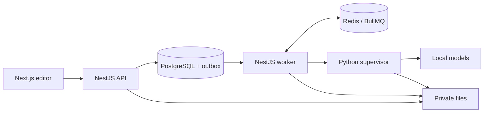

# Manga Voice Studio

[](https://github.com/Yurichz/manga-voice-studio/actions/workflows/ci.yml)
[](LICENSE)

A local comic voice editor: import pages, review dialogue, assign persistent character voices and assemble a chapter with synchronized highlighting. Images, text and audio are processed on your computer. The interface and system messages are English.

[Setup](docs/setup.md) · [Architecture](docs/architecture.md) · [Models](docs/models.md) · [Verification](docs/implementation-plan.md)


## Features

- PNG/JPEG/WebP and ZIP/CBZ import, page ordering and confirmed deletion.
- Manual region editing, OCR corrections, dialogue order, speakers, pauses and inclusion controls.
- Local AI page-analysis proposals and character-reference candidates that require confirmation.
- Synthetic voice design from a description, permitted WAV import and immutable voice versions.
- Utterance and chapter generation, current-audio cache reuse and explicit take selection.
- Russian number/pronunciation preparation with a preview of the actual synthesis text.
- Synchronized playback, WAV/ZIP downloads and independent MP3/JSON publication export.
- Progress, cancellation, retries, revision conflicts and fencing of late results.

AI assists the editor; review text, regions, reading order and speakers. Manual editing is available without a loaded GPU model. New projects default to English text and speech, with right-to-left reading order configured independently. Existing projects keep their languages, texts and audio. Automatic translation is not included.

## Stack and data flow

| Component | Technology |
| --- | --- |
| Editor | Next.js, React, TypeScript, TanStack Query, Zustand, SVG, Tailwind CSS |
| API | NestJS, Better Auth, Zod, BL/DA/CL layers |
| Persistence | PostgreSQL, Prisma, pgvector, private local files |
| Jobs | NestJS worker, BullMQ, Redis, transactional outbox |
| Inference | Python/FastAPI, Qwen3-VL, VoxCPM2, SigLIP2 |



## Windows quick start

Verified configuration: Windows, NVIDIA RTX 4090 with 24 GB VRAM, Node.js **26.3.1**, pnpm **11.25.0**, Python **3.12.13** managed by `uv`, and Docker Desktop with its Linux engine/WSL2. This is a tested configuration, not a minimum-hardware claim. Current model weights total about **15.34 GB**; environments, download cache and project data need additional space. Other operating systems and GPUs are not verified.

Install Git, the stated Node.js/pnpm versions, [uv](https://docs.astral.sh/uv/getting-started/installation/) and Docker Desktop. Start Docker Desktop and wait for the Linux engine.

```powershell
git clone https://github.com/Yurichz/manga-voice-studio.git
Set-Location manga-voice-studio
Set-ExecutionPolicy -Scope Process -ExecutionPolicy RemoteSigned -Force

.\scripts\setup.ps1
.\scripts\download-models.ps1
.\studio.cmd start
pnpm bootstrap
```

`setup.ps1` generates a local `.env` from the example with random secrets and installs pinned dependencies inside the project. The model downloader prints selected models and storage requirements before downloading. Bootstrap creates the first owner and writes the email/random password to `.runtime/owner-credentials.txt`. It refuses to replace an existing owner.

Open **http://localhost:3000**. Services bind to loopback. Use `studio.cmd stop` to stop owned processes and `studio.cmd diagnose` to diagnose a running application. Model weights, environments and user files are excluded from Git. See [setup and troubleshooting](docs/setup.md) for configuration and ports.

## Chapter workflow

1. Create a project and chapter, then import pages.
2. Draw regions manually or request AI proposals. Review text, order and speakers.
3. Design/import a voice, listen and save its profile. Assign voices to utterances.
4. Mark utterances reviewed and generate speech. Regenerate individual stale lines when needed.
5. Render the chapter, check synchronized playback and export. The separate publication package encodes the completed audio for an independent reader without running TTS again.

## English demo

The screenshot above comes from the actual read-only editor. It uses the [supplied English manga page](docs/assets/demo-manga.png), three panels and four manually annotated utterances. A synthetic English voice and all four recordings are generated with the local pinned models; the assembled WAV has a real sample-based timeline.

After setup and model download, prepare the demo once:

```powershell
.runtime\ai\Scripts\python.exe scripts/prepare_english_demo.py
.\scripts\demo.ps1
```

Run `pnpm dev:web` in a second terminal and open http://localhost:3000. Generation uses an isolated local supervisor and separate storage. Viewing needs neither PostgreSQL, Redis nor AI. `DEMO_ROOT` defaults to `storage/demo-english`; the older Russian regression fixtures remain separate. Generated voices, audio and demo data stay local and are excluded from Git. The generator resumes verified cached results; use `--regenerate` for a new voice.

## Development and verification

```powershell
pnpm build
pnpm lint
pnpm typecheck
pnpm check:architecture
pnpm test
pnpm contract:verify
```

GitHub Actions runs these checks without a GPU or user data. Real integration is opt-in:

```powershell
pnpm test:server:integration
pnpm test:server:gpu
```

These commands require Docker, local Python environments and test media. They use disposable databases, queues and separate storage. [CONTRIBUTING.md](CONTRIBUTING.md) explains fixture preparation and prerequisites. Use `pnpm dev:api`/`pnpm dev:worker` for source execution and `pnpm start:api`/`pnpm start:worker` for compiled applications.

The [English UI and demo verification report](docs/english-ui.md) records the current checks. Earlier full GPU and browser results are dated in the [implementation report](docs/implementation-plan.md).

## Documentation

- [Product scope](docs/product.md)
- [Installation, configuration, backup and troubleshooting](docs/setup.md)
- [Architecture](docs/architecture.md)
- [Model revisions and runtime behavior](docs/models.md)
- [NestJS BL/DA/CL boundaries](docs/nest-migration.md)
- [Publication export and reader integration](docs/editor-integration-audit.md)

## License

Original source: [MIT](LICENSE). Dependencies and models retain their own licenses; see [THIRD_PARTY_NOTICES.md](THIRD_PARTY_NOTICES.md). Use pages and recordings you have permission to process. Speech quality and recognition accuracy require review; there is no published real-manga accuracy benchmark.
