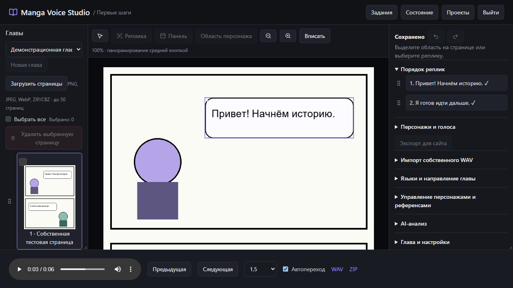
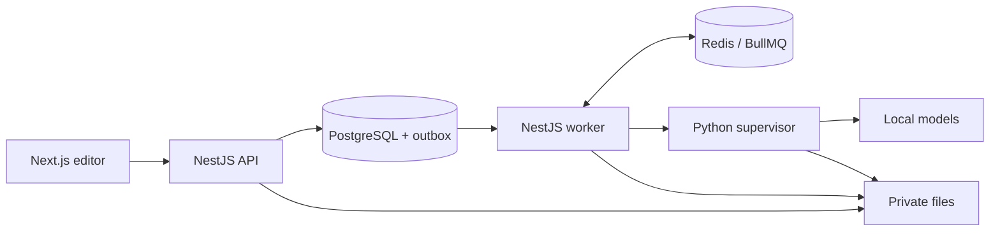

# Manga Voice Studio

[](https://github.com/Yurichz/manga-voice-studio/actions/workflows/ci.yml)
[](LICENSE)

Локальный редактор озвучки манги и комиксов. Загрузите страницы, проверьте реплики, закрепите голоса персонажей и соберите главу с синхронизированной подсветкой. Изображения, текст и аудио обрабатываются на вашем компьютере.

[English](README.en.md) · [Установка](docs/setup.md) · [Архитектура](docs/architecture.md) · [Модели](docs/models.md) · [Проверки](docs/implementation-plan.md)



## Возможности

- Импорт PNG, JPEG, WebP и ZIP/CBZ; порядок страниц и удаление с подтверждением.
- Ручная разметка областей, исправление OCR, порядок реплик, персонажи, паузы и выбор озвучиваемых фрагментов.
- Локальные AI-предложения разметки и кандидатов персонажей с ручным подтверждением.
- Создание синтетического голоса по описанию, импорт разрешённого WAV и сохранение версий голосов.
- Генерация отдельных реплик и глав; повторное использование актуального аудио и выбор дублей.
- Подготовка русских чисел и произношения с предпросмотром фактического текста синтеза.
- Плеер с подсветкой, WAV/ZIP и отдельный MP3/JSON-экспорт `.mvs-publication.zip`.
- Задания с прогрессом, отменой, повтором, проверкой версий и защитой от публикации устаревшего результата.

AI помогает редактору: текст, геометрию, порядок и говорящего нужно проверять. Ручное редактирование работает без загруженной GPU-модели. Интерфейс и основной сценарий ориентированы на русский язык; автоматического перевода нет.

## Стек

| Часть | Технологии |
| --- | --- |
| Редактор | Next.js, React, TypeScript, TanStack Query, Zustand, SVG, Tailwind CSS |
| API | NestJS, Better Auth, Zod, архитектура BL/DA/CL |
| Данные | PostgreSQL, Prisma, pgvector, приватное файловое хранилище |
| Задания | NestJS worker, BullMQ, Redis, transactional outbox |
| Инференс | Python/FastAPI, Qwen3-VL, VoxCPM2, SigLIP2 |



## Быстрый старт на Windows

Проверенная конфигурация: Windows, NVIDIA RTX 4090 с 24 GB VRAM, Node.js **26.3.1**, pnpm **11.25.0**, Python **3.12.13** через `uv` и Docker Desktop с Linux engine/WSL2. Это проверенная машина, а не обещание минимальных требований. Текущим моделям требуется около **15.34 GB** весов, дополнительно — место для окружений, загрузочного кэша и данных. Другие ОС и видеокарты пока не проверены.

Установите Git, указанные Node.js/pnpm, [uv](https://docs.astral.sh/uv/getting-started/installation/) и Docker Desktop. Запустите Docker Desktop и дождитесь готовности Linux engine.

```powershell
git clone https://github.com/Yurichz/manga-voice-studio.git
Set-Location manga-voice-studio
Set-ExecutionPolicy -Scope Process -ExecutionPolicy RemoteSigned -Force

.\scripts\setup.ps1
.\scripts\download-models.ps1
.\studio.cmd start
pnpm bootstrap
```

`setup.ps1` создаёт `.env` из примера с локальными случайными секретами и устанавливает закреплённые зависимости в проект. `download-models.ps1` показывает выбранные модели и объём до загрузки. Bootstrap создаёт первого владельца; email и случайный пароль находятся в `.runtime/owner-credentials.txt`. Повторный bootstrap не перезаписывает владельца.

Откройте **http://localhost:3000**. Сервисы слушают loopback. Остановка — `studio.cmd stop`, диагностика запущенного приложения — `studio.cmd diagnose`. Модели, окружения и пользовательские файлы в Git не входят. Подробности, порты и решение проблем — в [руководстве установки](docs/setup.md).

## Работа с главой

1. Создайте произведение и главу, загрузите страницы.
2. Создайте разметку вручную или запустите AI-анализ. Проверьте текст, порядок и персонажей.
3. Создайте/импортируйте голос, прослушайте его и сохраните профиль. Назначьте голоса репликам.
4. Отметьте реплики проверенными и запустите озвучку. Неактуальные фрагменты можно пересоздавать отдельно.
5. Соберите главу, проверьте плеер и скачайте результат. «Экспорт для сайта» создаёт пакет для независимого читателя без повторного TTS.

## Разработка и проверки

```powershell
pnpm build
pnpm lint
pnpm typecheck
pnpm check:architecture
pnpm test
pnpm contract:verify
```

GitHub Actions выполняет эти проверки без GPU и пользовательских данных. Интеграционные тесты включаются отдельно:

```powershell
pnpm test:server:integration
pnpm test:server:gpu
```

Этим командам нужны Docker, локальные Python-окружения и тестовые медиа. Они создают отдельные БД, очередь и хранилище. Подготовка фикстур и условия запуска — в [CONTRIBUTING.md](CONTRIBUTING.md). Для разработки API/worker доступны `pnpm dev:api` и `pnpm dev:worker`; собранные приложения запускаются через `pnpm start:api` и `pnpm start:worker`.

На **2026-10-28** проверены 17 модульных, 28 интеграционных и 13 браузерных сценариев, включая реальные локальные модели. Это результаты конкретной Windows-конфигурации. Границы и состав проверок — в [отчёте](docs/implementation-plan.md).

## Документация

- [Продукт и ограничения](docs/product.md)
- [Установка, конфигурация, резервное копирование и диагностика](docs/setup.md)
- [Архитектура и разделение ответственности](docs/architecture.md)
- [Модели и версии](docs/models.md)
- [NestJS и BL/DA/CL](docs/nest-migration.md)
- [Формат экспорта и интеграция с читателем](docs/editor-integration-audit.md)

## Лицензия

Собственный код — [MIT](LICENSE). Зависимости и модели сохраняют собственные лицензии: [THIRD_PARTY_NOTICES.md](THIRD_PARTY_NOTICES.md). Используйте страницы и голосовые записи, на обработку которых у вас есть права. Субъективное качество озвучки и точность распознавания требуют проверки; опубликованного бенчмарка на реальной манге нет.
